* Project 2 Cache Profiling

** Building and Running:

#+BEGIN_SRC sh
make                               # build
./scripts/run_experiments.sh quick # run experiments. full for bigger memory footprint
python ./scripts/collect_perf.py   # optional requires perf and might need sudo
python ./scripts/plot_results.py
#+END_SRC

** My Computer Specific Info:

All of the tests are ran on a 5.1 GHz max cpu core with 48KB of L1d cache,
2048KB of L2 cache, and 24MB of L3 cache.

** Implementation Details:

~./membench latency~ build a random cycle of pointers. Then it creates K chains
allowing zero-queue dependent load latency between each chain. each cain starts
at different locations on the same random cycle. These K chains increase
memory-level parallelism. It then calculates the per chain latency after running
the entire cycle and reports =ns_per_step= and =GiB/s=. Little's Law predicts
for this that ~throughput = K / latency~.

~./membench bandwidth~ runs in either read, write, 70/30, or 50/50 mode. Read
mode does 64 bit loads and just XOR's all of them together to stop the compiler
from removing the loop. This loop is also partially unrolled. The Write mode
writes the index to every step in the array. the 70/30 and 50/50 modes mix these
two approaches. These can also be sent into a stride mode much like how the cpu
kernels were in project1. There is also a random mode which creates a random
covering walk over the entire array and goes through that.

Memory is all allocated with ~mmap~ and ~MADV_HUGEPAGE~ is optionally applied to
check the difference of huge pages.

** Pre-experiment hypotheses:

1. Random reads/writes will always be slower than doing a sequential
   reads/writes. This will be the same with running the reads with a stride of
   more than one.
2. Bandwidth should be very high when getting cache hits, but when the cache
   expended there should be a very measurable drop as DRAM speeds start getting
   used.
3. latency should start out really low because of using cache but should
   increase when DRAM starts getting used.
4. Increasing the number of chains in latency should increase throughput until
   the memory controller starts throttling.

** Experiments:

| Study                               |   Plots |
|-------------------------------------+---------|
| Zero-queue latency                  | 1, 2, 3 |
| Working-set / cache transitions     |    1, 3 |
| Pattern / Granularity / Stride      |    4, 5 |
| Read/Write mix                      |       6 |
| Intensity / throughput-latency knee |       7 |
| Cache / TLB miss rates vs runtime   |       8 |
| TLB / huge pages                    |       9 |
| Benchmark pitfall                   |      10 |

** Plot analysis:

*** Latency

These graphs both measure some form of latency. The jumps in latency for the
working set size is exactly as expected, where there is a jump up after being
flat. This is because the cpu has to get the data from a higher latency
location, but once it is there the latency stays mostly the same.

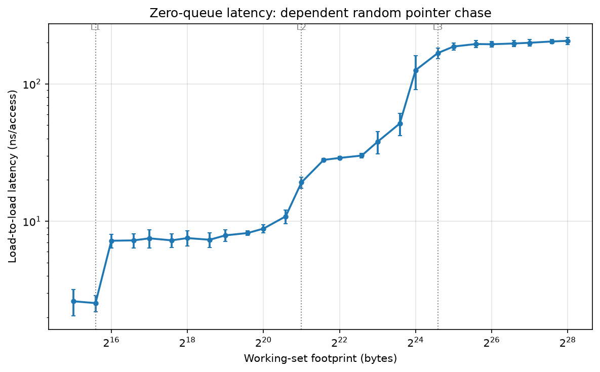

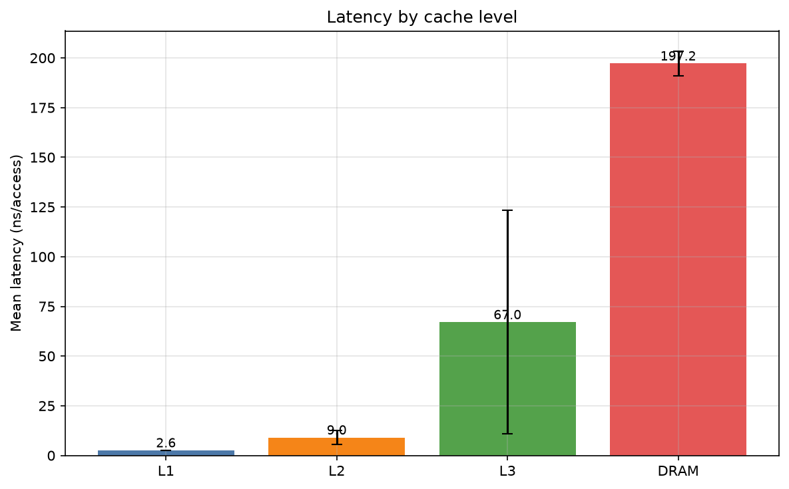

*** Bandwidth

The bandwidth trends as expected. They all start out high as working set is
small but as the working set grows the bandwidth decreases due to increased
latency.

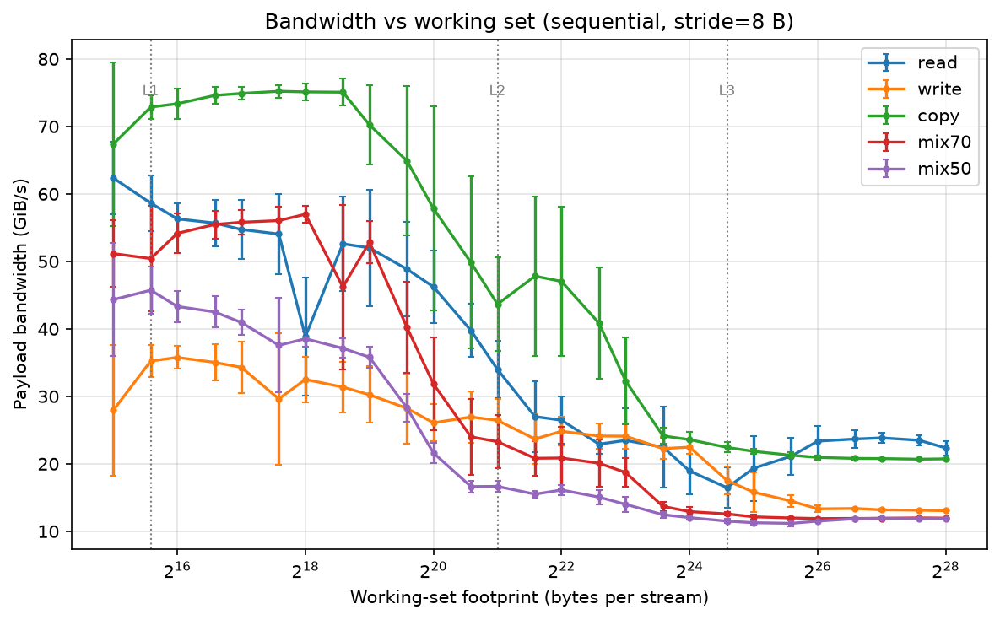

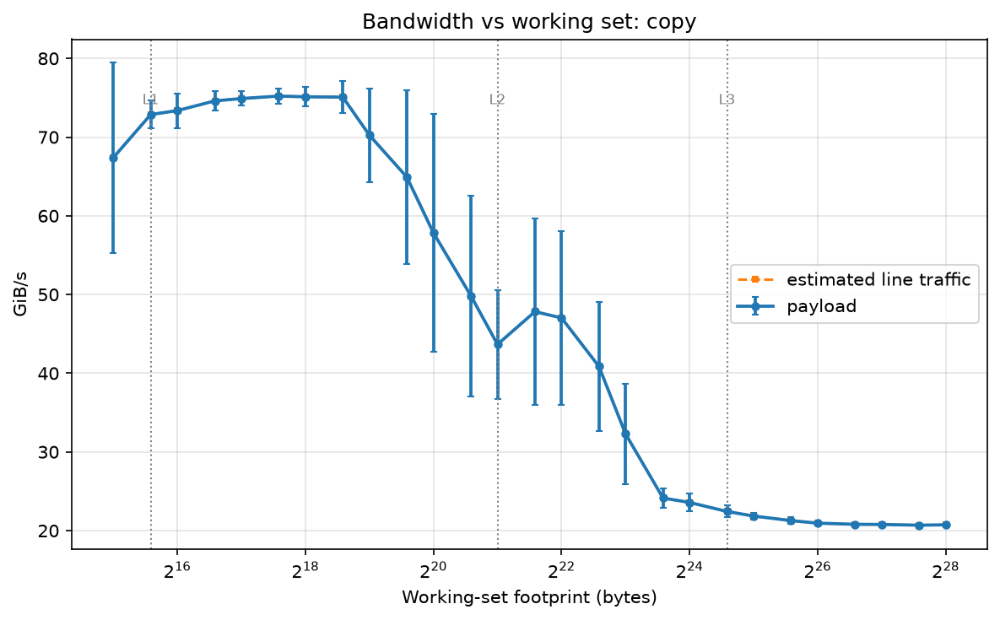

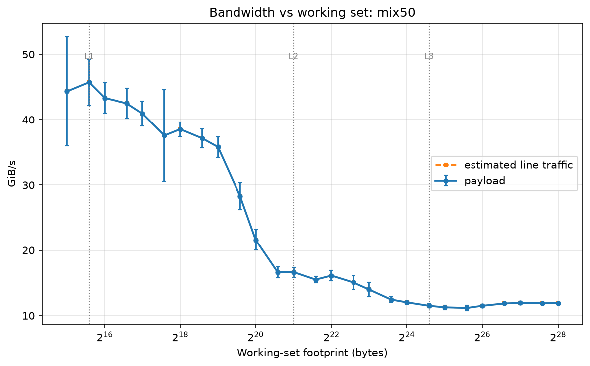

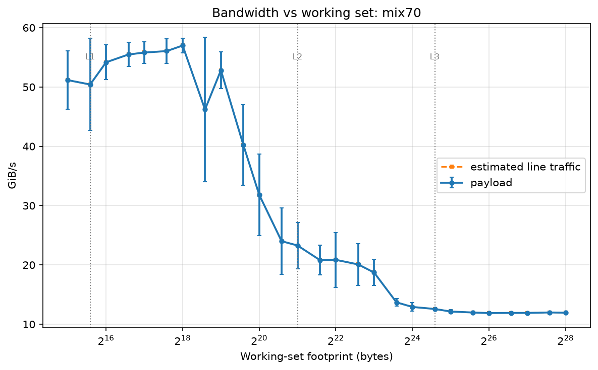

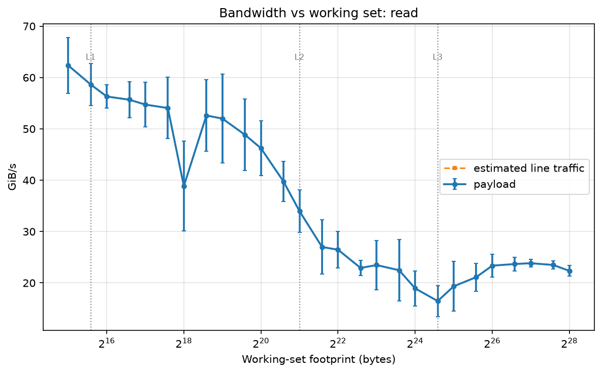

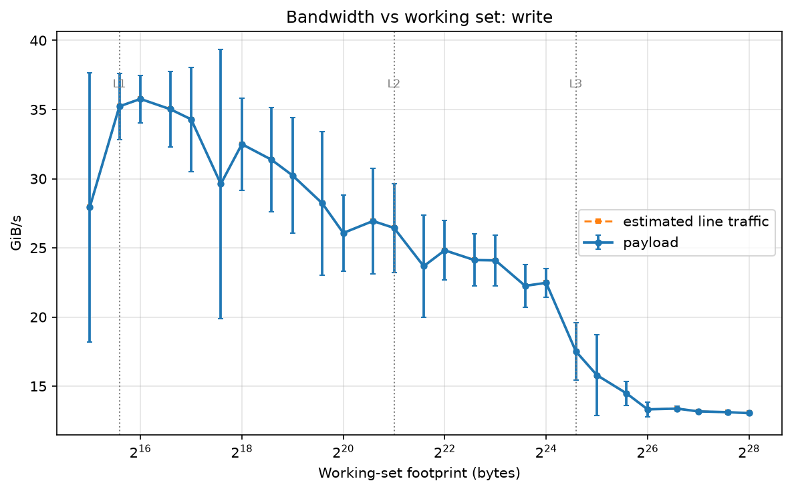

*** Stride's effects

The first graph is a sequential iteration of large strides. This causes lots of
cache misses and keep pulling into the cache. That is the main cause from the
sawtooth shape, because one access misses and then the next one hits and the
next one after that misses again. The random graph has every cache missing which
is why there is no sawtooth pattern found.

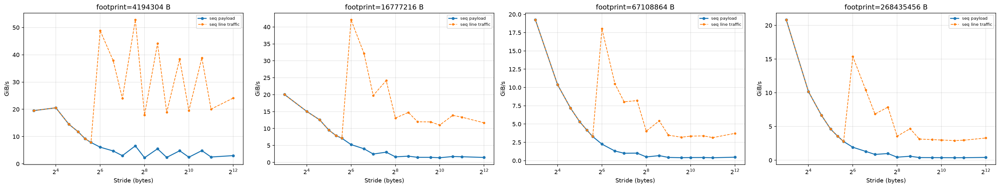

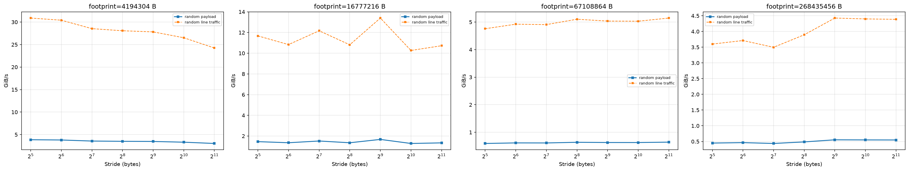

*** Read/Write mix

This lots of bar graphs of read and write times for fixed size arrays. the two
mixed version always are slower. This is most likely because of the cpu having
to change what things its operating between, which can screw up the branch
predictor or the cache training.

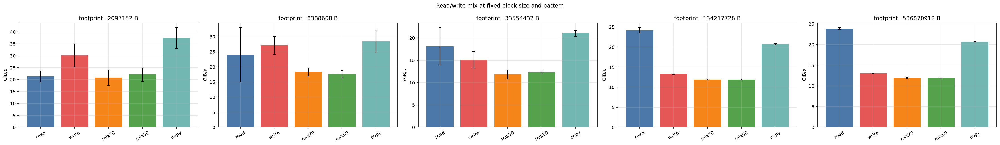

*** Throughput-latency knee & Little's Law

These graphs have latency graphed vs throughput for different values of K
chains. They start with low latency because there is not many memory lookups
running, but as you increase K, the throughput increases because many of those
accesses can be sent at the same time to the memory controller. The sending of
more requests causes a slight increase of the latency until the cpu hits the
point of memory controller saturation. where sending more requests to the memory
controller just increases the latency because of DRAM wait time. This matches up
with Little's Law, which is the second graph, very well with the slope matching
pretty closely.

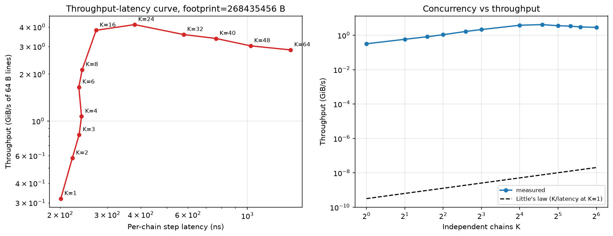
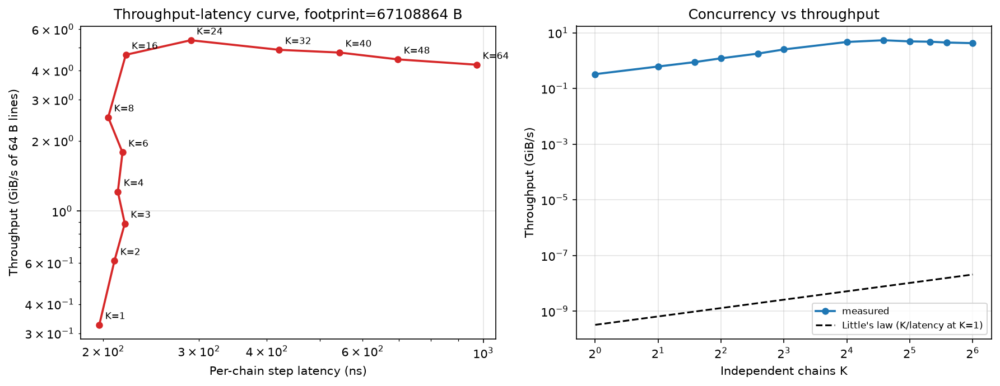

*** Perf statistics

These graphs show the cache/LLC/TLP miss rates for 1, 8, 32, and 512 MiB
footprints given by perf, along with the latency for those same miss rates.

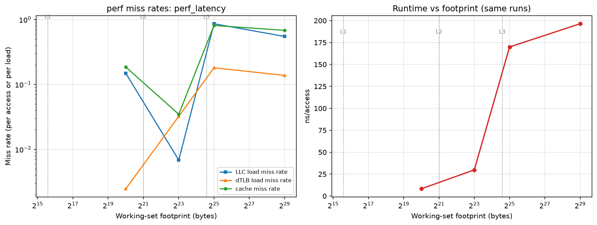
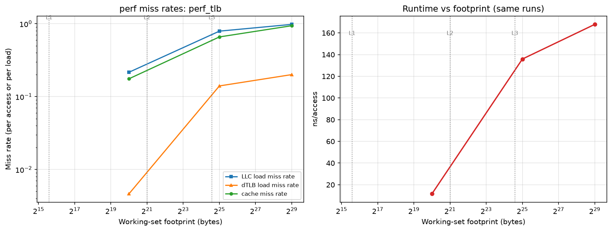

*** Huge Pages

This graph shows how huge pages effects the lookup time for data. The huge pages
seem to give a slight latency increase most likely due to some overhead from the
linux kernel.

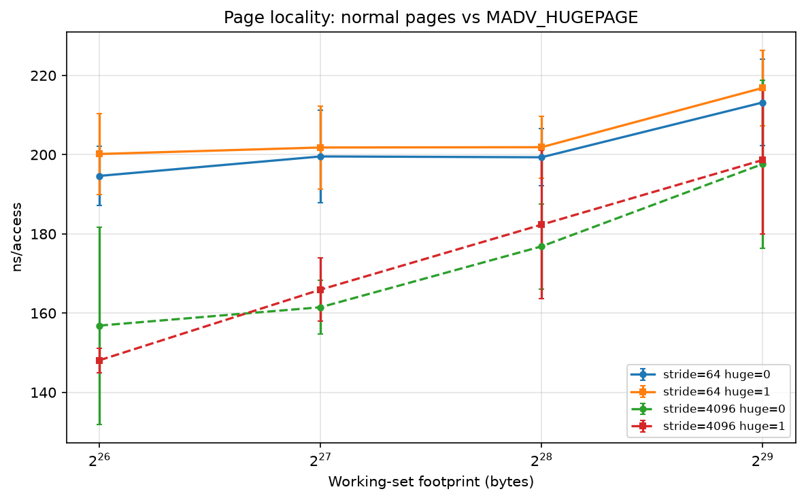

*** Pitfalls/Failures

In this case the throughput for the DRAM run 1024 MiB look much faster, but that
is because of the prefetcher in the cpu causing the speedup. not because DRAM is
acually running faster than the L3 cache. When running it as a random walk you
can see the latency increase a ton while sequentially there is almost no
latency.

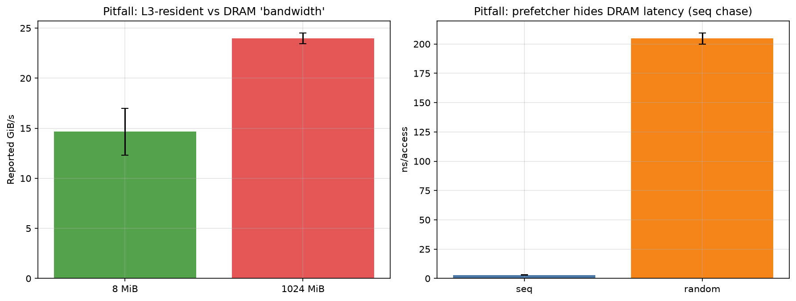
