* Project 3 SSD Profiling

** Running:

=fio= must be installed. It is perferable if this can be done on a trash
partition on your SSD or on some other external SSD. But it can just be ran on a
file. Any target will be corrupted with random data.

#+BEGIN_SRC bash
export TARGET=/path/to/drive-or-file     # will not run if it is a system path
export CONFIRM_DESTRUCTIVE=I_UNDERSTAND
export TEST_SIZE=8G                      # could be bigger if you want
./scripts/run_experiments.sh quick       # run with full for longer more thorough test
python ./scripts/plot_results.py
#+END_SRC

** My System Specifics:

This was ran on a file in my main filesystem which is already some overhead. My
root partition is running on btrfs with zstd compression over LUKS disk
encryption. The target was a file with Copy on Write turned off decreasing the
overhead from the filesystem, and doing direct IO. Unfortunately I don't have
any spare SSD's sitting around for me to test raw speeds on but this is the best
that I have.

** Pre-experiment hypotheses:

1. Increased queue depth will increase the throughput up until some point where
   the throughput will flatten out and not increase any more.
2. Random reads and writes should not be that different because SSD's already
   store memory fragmented across many locations.
3. Reads should be faster than writes because writes can trigger garbage collection.
4. the read/write mixes should be somewhere in between read and write speeds.

** Experiments:

| Study                                                     |    Plots |
|-----------------------------------------------------------+----------|
| QD=1 baselines (4K random R/W, 128K seq R/W) with p95/p99 |        1 |
| Block-size sweep, random + sequential                     |        2 |
| Read/write mix (100/0 down to 0/100 in 10 % steps)        |        3 |
| QD / parallelism sweep, knee, Little's Law                | 4, 5, 10 |
| Tail latency at mid and near-knee QD                      |        6 |
| LBA range / working set                                   |        7 |
| Device state (burst vs steady)                            |        8 |
| Buffered-I/O and effective-QD pitfalls                    |        9 |

** Plot Analysis:

*** QD=1 Baselines

This is the baseline IOPS for reading, writing, sweep reading, and sweep writing
along with completion latency for p99, p99.9 and mean.

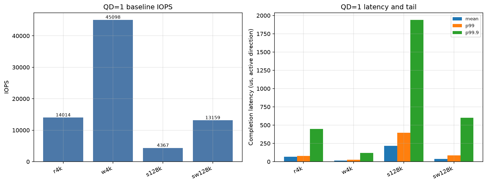

*** Block size sweep for random & sequential writes

The throughput goes up when increasing block size because of the reduction if
IOPS to get the SSD to write data. Though the latency increase at the same time
because you have to wait for the read/write to succeed. There also isnt really a
difference between the numbers for random and sequential for QD=1, but the
numbers for random with QD=32 is much faster than the QD=1 numbers for random as
expected.

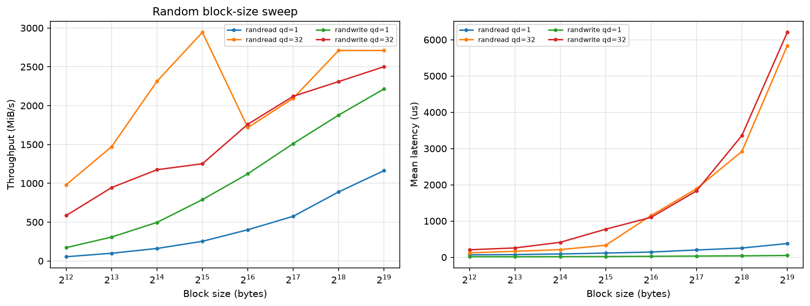

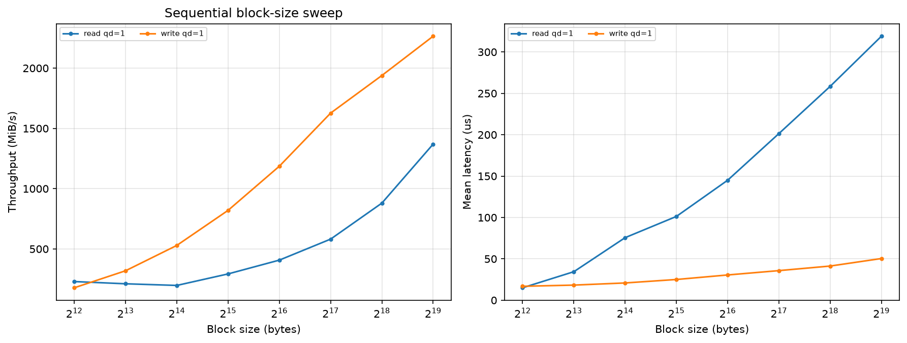

*** Read Write mix

The latency seems to just decrease as there are more reads being done. This is
probably due to the SSD not having to do as much garbage collection or writing
of blocks. The graph on throughput is more interesting because QD=1 and QD=8 are
both decreasing while QD=32 is increasing as there are more reads. This could be
because when the cpu issues a write it can almost immediately return but when
issuing a read it actually has to wait for the SSD to return the data. The
reason that QD=32 seems to not be effected is because it has more queued
operations to wait on so it can read whichever ends first. I think that the
random spike in the middle of the QD=1 and QD=8 graphs is just random other
things happening in the background and it should be ignored

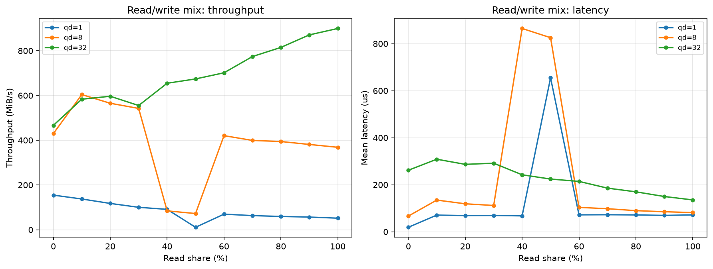

*** Little's Law

These graphs all show how accurate Little's Law is. The IOPS increase as the
queue depth increases but once it hits a point where full bandwidth is achieved
the increase of throughput is minimal while still increasing latency. This is
the same for both reads and writes.

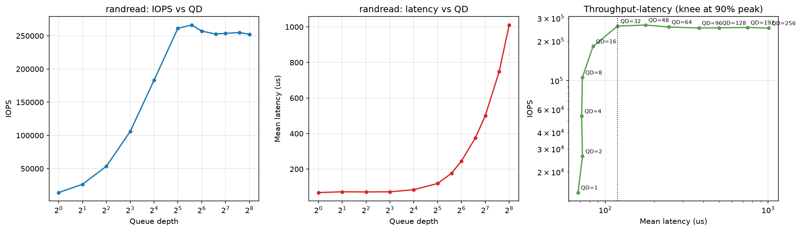

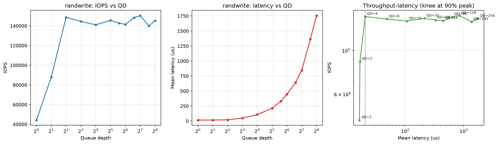

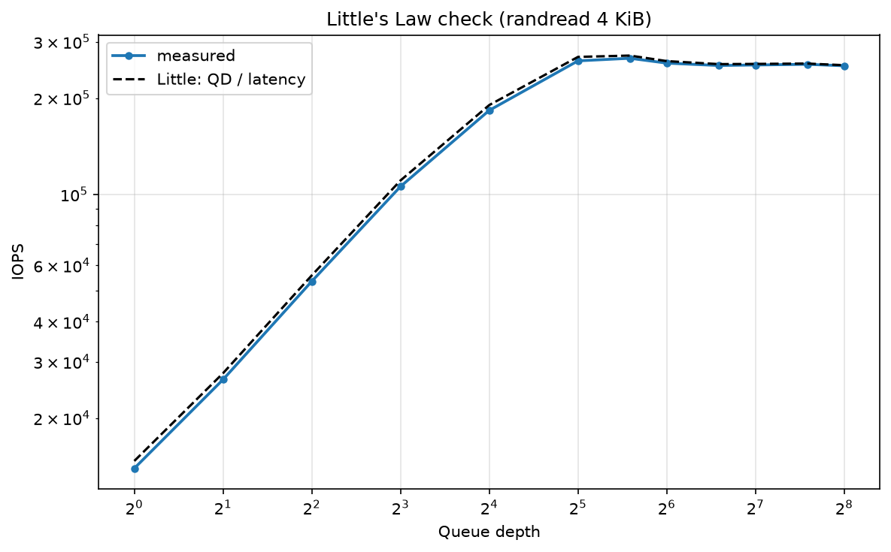

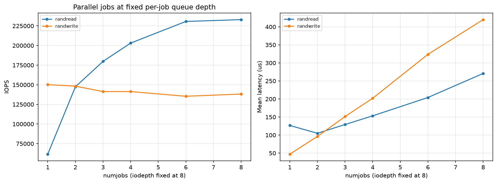

*** Tail latency

This shows the tail latency for all 50,95,99,99.9th percentiles based off of
queue depth. As expected latency will increase when you get closer to the knee
of Little's Law.

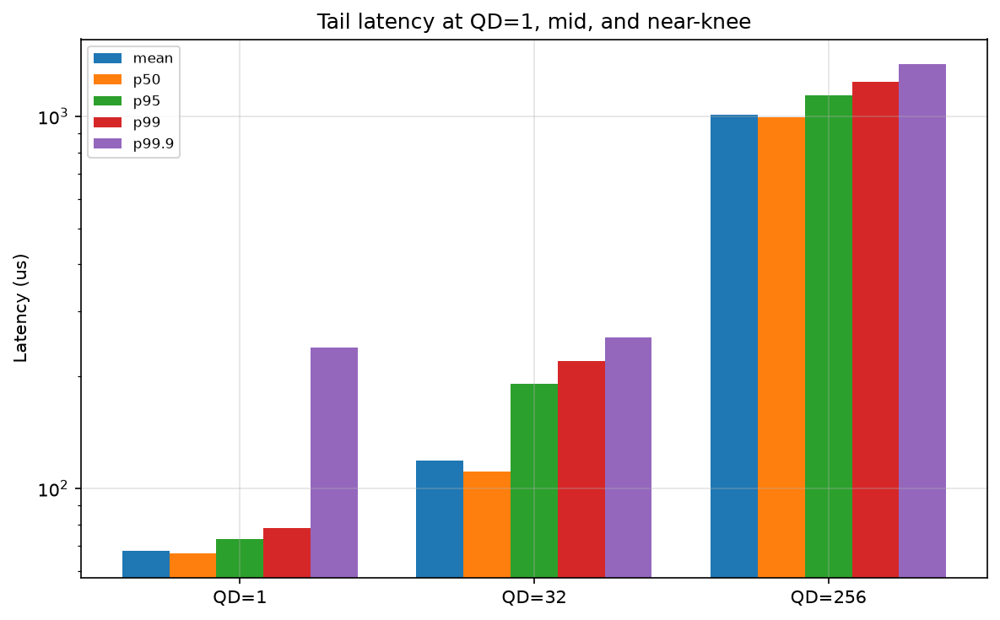

*** Logical Block Address

LBA is nearly irreverent because reading and writing to any possible location is
very fast for an SSD. You would see a difference more in something that would be
effected by how big the LBA was, such as a tape drive that would have to wind
all the way to the location.

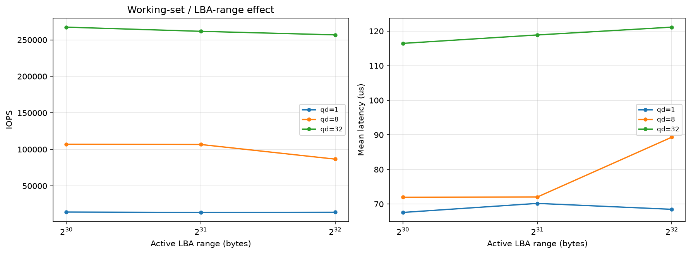

*** Device State

This is just a graph of my device's state before and after the tests. It was the
exact same so there was most likely nothing doing IOPS on the SSD but there
could have been because this test is not very thorough.

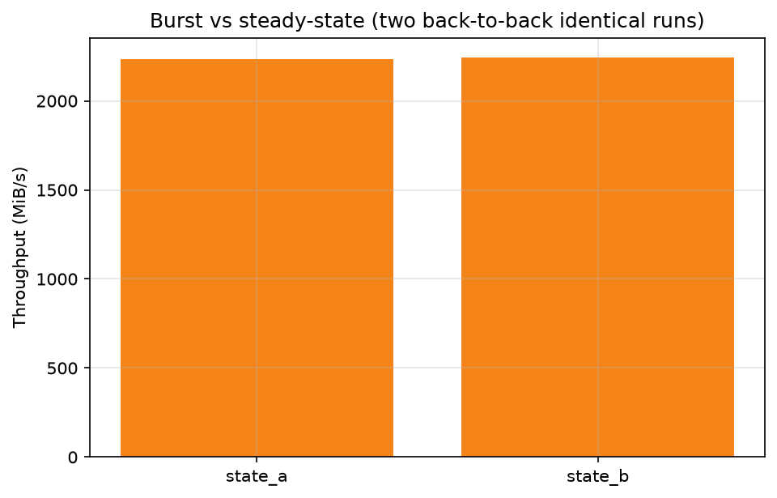

*** Pitfalls

Buffered IO and Direct IO both produced similar IOPS but the Buffered IO gave a
much smaller latency, this is because of the page cache. If incorrectly used as
the actuall latency for tests this could have given very wrong numbers. Also
~iodepth * numjobs~ is not a sufficient way to determine the speed of some given
operation, in the second graph the they have the same product but gave different
results. Assuming these are equivalent is another way that numbers could get
screwed up.

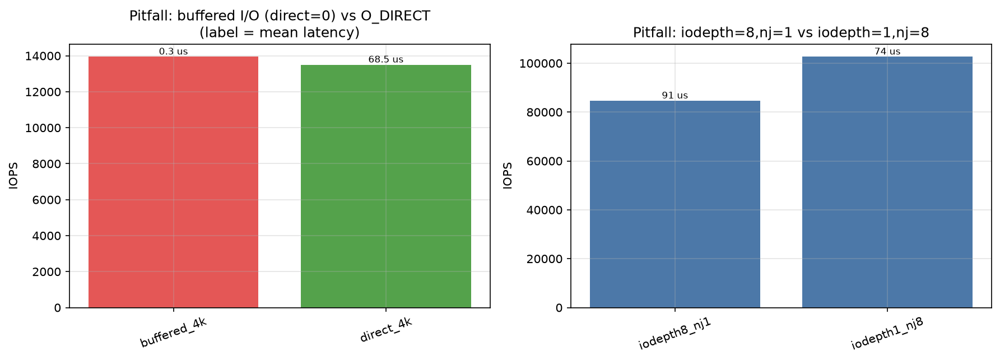
